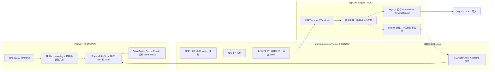
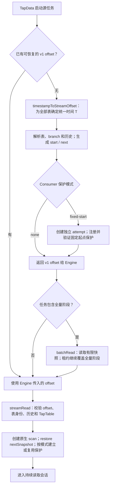
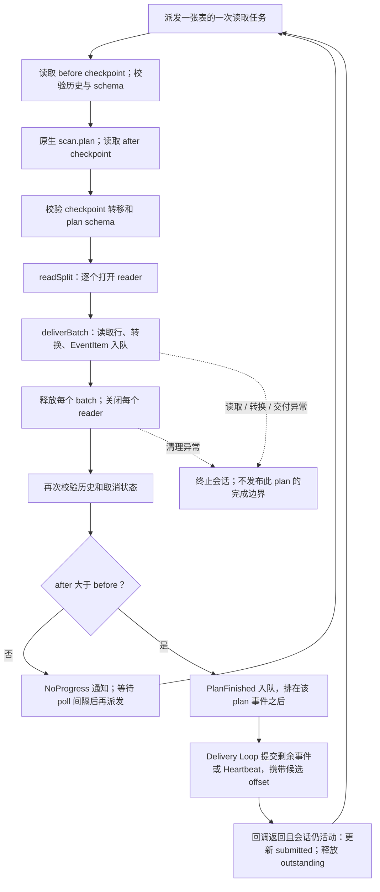
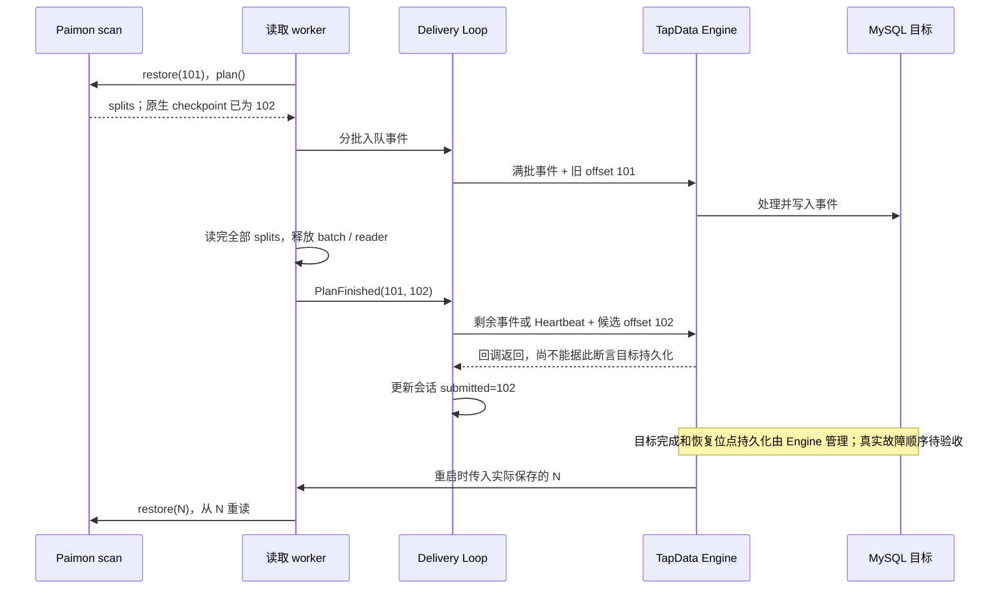
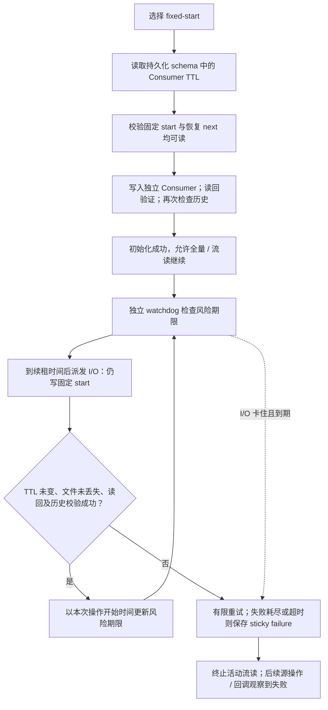
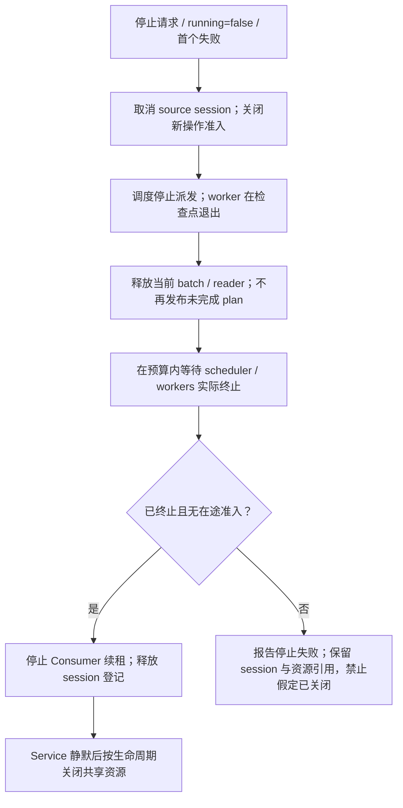

# Paimon 源端读取架构与使用说明

本文说明当前连接器如何持续消费 Paimon 数据、转换类型、交付 TapData 下游，以及如何恢复和停止。下游以 MySQL 为例。

实现基线：`codex/paimon-stream-read@f1f420cc`；Paimon 依赖 **1.3.2**，源码核对固定在 release-1.3 commit `5c59e6cb01ed0b29563371f56e14fcade4597a2e`；PDK API **2.0.8-SNAPSHOT**。本文描述已实现行为；真实 Engine→MySQL 故障恢复和生产容量仍需验收。源码入口与验证证据见文末。

## 1. 总体架构与责任边界

连接器持续扫描 Paimon **已提交快照及原生增量/changelog 文件**，通过 Paimon Java API 读取行，再输出 TapData 标准事件。新提交出现后继续读取；没有新数据时等待下一次轮询，直到任务停止或发生错误。



- **Paimon 内核**负责 delta/changelog 选择、split 规划、文件读取和历史 schema 投影。连接器不自行解析 manifest，也未移植 Flink Source 或引入 Flink runtime。
- **本连接器**负责轮询、多表调度、类型适配、交付边界、恢复位点校验和自身生命周期。
- **TapData Engine**负责任务链路、目标调用及位点持久化。连接器不会直接连接 MySQL，也不会自己写 Engine 的状态库。
- **MySQL 连接器**负责目标类型转换、SQL/JDBC 写入与写入结果。目标主键、写入策略、DDL 和时区会影响最终结果。

`StreamReadConsumer` 是 TapData 交付回调；Paimon `Consumer` 是历史保留元数据。两者用途不同。

## 2. 从任务启动到持续读取

### 2.1 首次启动与恢复入口



时间初始化遵循当前连接器政策：所有表使用同一个 T；逐表寻找 `commit time <= T` 的最高快照编号 S，返回 `S + 1`。T 为 null 时，Connector 入口捕获一次当前时间。空表从 1 开始；未来时间、负时间或无法证明完整的历史起点明确失败。

这里使用 Paimon **提交时间**，不等同于行的业务时间；`<= T` 也不等同于 Paimon 原生 from-timestamp 的 `< T` 规则。多表初始化不构成跨表一致快照。

### 2.2 全量与增量的区别

| 项目 | 全量 `batchRead` | 增量 `streamRead` |
|---|---|---|
| 扫描入口 | `ReadBuilder.newScan()`，一次有限 plan | `ReadBuilder.newStreamScan()`，反复 plan |
| 记录 | 输出最终状态的 INSERT / UPDATE_AFTER；过滤 DELETE / UPDATE_BEFORE | 按原生 RowKind 交付，映射规则见第 4 节 |
| 类型转换 | 使用 `decodeForEvent` | 使用 `decodeForEvent` |
| 恢复状态 | 当前不使用传入的 batch offset；回调携带 null | 使用版本化的每表 nextSnapshot |
| 完成方式 | 所有 splits 读完后返回 | 等待后续提交，直到停止或出错 |

全量扫描与较早初始化的增量起点可能重叠。下游需容忍重放；本实现没有增加全量的逐行断点或跨阶段原子快照。只读查询接口使用 `decode`，返回独立 Java Map/List，不使用事件专用的 JSON 字符串载体。

## 3. 一个持续读取会话内部如何工作

### 3.1 调度与线程

一次 `streamRead` 调用是同步的长驻调用。每张表绑定自己的 scan、TableRead、decoder 和 schema guard；同一 Service 不允许两个活动的 stream 会话。

| 角色 | 工作内容 |
|---|---|
| 调度线程 | 派发每表的一次 plan；根据完成通知或无进展通知决定何时再派发 |
| 有限 worker 池 | 执行 plan，顺序读取该 plan 的 splits，转换并入队事件 |
| 原调用线程中的 Delivery Loop | 消费共享队列、组批、串行调用 TapData 回调、更新会话内候选位点 |
| 可选 Consumer watchdog 与 I/O 池 | 独立检查保护期限和续租，不依赖下游回调速度 |

worker 数量为 `min(请求表数, JVM 可用处理器数)`；没有每表永久驻留线程。同一表在完成标记交付前保持 outstanding，不并发推进该表的下一次 plan。不同表可以交错交付，不承诺跨表事务顺序。

事件队列容量为 `10 × eventBatchSize`，其中也包含内部完成标记。队列满时 worker 等待，形成向读取端传播的背压。容量是条数而非字节预算，大字段仍可能占用大量内存。

### 3.2 plan 的读取与交付



图中 splits 或 batch 为空时直接进入后续校验。原生 `plan()` 可能已经跨过多个空快照；即使没有业务事件，只要 after 前进，也必须交付完成边界。原生 `plan()` 内部可能循环或阻塞，连接器不承诺一次调用具有固定耗时上限。

Delivery Loop 有三种提交时机：

1. 事件达到 `eventBatchSize`：提交一批，携带各表目前最后已交付完整 plan 的位点。
2. 未满批，但从第一条待提交事件起达到 flush 间隔：尝试提交该批，仍不提前完成正在读取的 plan。
3. 收到 `PlanFinished`：立即提交剩余批次并推进对应表的候选位点；若批次为空，发送一个标准 `HeartbeatEvent` 承载新位点。

内部 `PlanFinished` 不发送给 Engine；也不使用空事件列表保存位点。批次发布后不清空或复用该 List。回调阻塞时，flush 间隔不构成端到端延迟保证。

## 4. 类型转换与 MySQL 交付

### 4.1 schema 与转换链路

连接器发现 Paimon schema，生成 TapTable 字段、SQL 类型、nullable 和主键信息；PDK 根据 `spec.json` 生成 TapType。流读启动时核对 TapTable 与绑定的物理 schema，每次 plan 前继续检查结构及读取语义。

```mermaid
flowchart LR
    A["Paimon InternalRow + RowKind"] --> B["schema 绑定 decoder：原生 FieldGetter"]
    B --> C["自有 Java 值；二进制复制；复杂值递归解码"]
    C --> D["事件复杂列编码为标准 JSON 字符串"]
    D --> E["TapInsertRecordEvent / TapDeleteRecordEvent"]
    E --> F["TapData 源端 To codec：按 TapType 恢复复杂类型并处理时间"]
    F --> G["Engine 处理与路由"]
    G --> H["MySQL 目标 From codec"]
    H --> I["MySQL writeRecord / JDBC 参数绑定"]
    I --> J["MySQL 列、约束与事务"]
```



decode 在 reader batch 释放前完成。顶层二进制复制，复杂值转成新的 Map/List，避免异步消费持有会被 reader 复用的存储对象。

| Paimon 类型 | decoder 的顶层输出 | TapData / MySQL 适配要点 |
|---|---|---|
| BOOLEAN | Boolean | 按源 TapType 和目标布尔/数值列映射 |
| TINYINT / SMALLINT / INT / BIGINT | 对应 Byte / Short / Integer / Long | 正常有模型的 PDK 路径保留整数值；本地合同覆盖 Long 极值 |
| FLOAT / DOUBLE | Float / Double | 保留浮点语义；不能因此承诺所有非有限数都可写入 MySQL |
| DECIMAL | BigDecimal | 保留 precision/scale 对应的值；目标列仍须能表示该值 |
| CHAR / VARCHAR / STRING | String | 字符集与长度由实际 MySQL DDL 约束 |
| BINARY / VARBINARY | 复制后的 byte[] | 目标 JDBC 二进制绑定；不复用 reader 缓冲 |
| DATE | java.sql.Date，按 epoch-day 构造 | 表达日历日期；已有跨 JVM 时区合同测试 |
| TIME | 附在 1970-01-01 上的 LocalDateTime | 源精度为 0–3；按 TapTime 进入时间 codec |
| TIMESTAMP | LocalDateTime | 保留墙钟字段及纳秒；源 codec 使用显式 UTC 编码载体，字段仍是无时区类型 |
| TIMESTAMP_LTZ | UTC ZonedDateTime | 保留 instant；实际 MySQL TIMESTAMP 的会话时区需往返验证 |
| ARRAY | List，事件阶段转 JSON 字符串 | 源 codec 按 TapArray 恢复外层类型，MySQL codec 输出 JSON 表示 |
| MAP / ROW | Map，事件阶段转 JSON 字符串 | 源 codec 按 TapMap 恢复；ROW 使用字段名作为键 |

正常有模型的数值不一定全部包装为 TapNumberValue；不能把读取路径描述成“先统一转 Double”。合同测试同时覆盖默认 CDC 和 schema-enforced 全量转换路径。

复杂列为何要经过 JSON：PDK 的递归遍历会先包装嵌套 Map，直接透传容易让 MySQL codec 再次把子对象编码成 JSON 字符串。标准 JSON 载体让其穿过递归遍历，源 `String` codec 再按声明的 TapMap/TapArray 恢复外层类型。普通字符串仍保持字符串。

复杂值的明确约束：MAP 键必须为非 null 的 CHAR/VARCHAR 字符串；嵌套 binary 表示为 Base64，日期/时间表示为 ISO 文本；数组 null 元素在解码和本地直接 codec 合同中保留。非字符串或 null Map 键、MULTISET、VARIANT、嵌套 NaN/Infinity 明确失败。实际 Engine 传输/溢写是否保留所有复杂值还需黑盒测试。JSON 载体会增加编码、解析与内存分配成本。

### 4.2 行变更如何变为事件

| Paimon RowKind | TapData 事件 | 数据位置 |
|---|---|---|
| INSERT | TapInsertRecordEvent | after |
| UPDATE_AFTER | TapInsertRecordEvent | after |
| DELETE | TapDeleteRecordEvent | before |
| UPDATE_BEFORE | TapDeleteRecordEvent | before |

当前不配对合成 TapUpdateRecordEvent。例如原生 changelog 中的 `-旧值、+新值` 会交付为删除、插入两条事件；这两条是否在 MySQL 形成同一事务由目标执行决定。事件 `referenceTime` 使用连接器读取时刻，不是原始业务事务时间。

主键表 `changelog-producer=none` 的更新可能只有新状态，未必有 before image；`input/lookup/full-compaction` 的实际输出由 Paimon producer 和 writer/compaction 决定。原生 overwrite 默认可能被跳过，具体选项见参数表。不能把所有 Paimon 表都视为具有完整数据库 binlog。

### 4.3 下游正确性要求

下游要能按任务配置处理重复插入、覆盖和删除。尤其是重放或只有 UPDATE_AFTER 的场景，必须核对 MySQL 主键及冲突处理策略；源端不能保证无主键 append 目标自动去重。

连接器保留源精度，不自动决定有损转换。TIMESTAMP(7–9) 的 MySQL codec 输出存在降到微秒的情况；高 scale Decimal、超出目标日期范围的值以及 LTZ 的目标列/session 时区都需要明确策略。连接器单元测试和 JDBC 参数绑定正确，不等于数据库落库无损。具体证据见 [MySQL 类型审查](validation/stream-read-mysql-type-review.md)。

## 5. 位点与恢复

### 5.1 三种不同的进度

| 进度 | 含义 | 是否足以证明下游持久化 |
|---|---|---|
| 原生 scan checkpoint | 下次要消费的快照 id；可能在当前 splits 读完前已经推进 | 否 |
| session submitted offset | 完整 plan 的回调返回，且会话仍活动后接受的候选位点 | 否 |
| Engine 恢复 offset | Engine 根据自己的链路与持久化规则保存，并在重启时传入 | 恢复依据；端到端顺序仍需验证 |

位点含义是 **next-to-consume**。恢复使用 `restore(N)`，不能再加一。连接器显式设置临时 Table 副本的 `consumer.ignore-progress=true`，避免表中已有 Consumer 进度替代 Engine 传入的起点；不修改持久化表配置。

```json
{
  "kind": "tapdata-paimon-stream",
  "version": 1,
  "readEpoch": "00000000-0000-0000-0000-000000000001",
  "tables": {
    "orders": {
      "physicalTableHash": "aaaaaaaaaaaaaaaaaaaaaaaaaaaaaaaaaaaaaaaaaaaaaaaaaaaaaaaaaaaaaaaa",
      "startSnapshot": "101",
      "nextSnapshot": "101"
    }
  }
}
```

示例仅用于解释结构，不能手工套用到实际任务。hash 由实际 location 与 branch 规范化后计算；快照编号编码为十进制字符串；readEpoch 标识一轮初始化。startSnapshot 始终保留该 epoch 的初始起点，nextSnapshot 随完整 plan 边界前进。推进一张表时复制 envelope，不改变其他表或已经交付的 Map。

请求表缺失、旧无版本 Map、null offset、未知字段/版本、编号溢出、next 小于 start、物理来源不匹配都会拒绝；额外未请求表的位点保留。运行中完成标记还必须与本地前一边界连续。重启传入较早的有效位点属于正常重放。初始化失效时需通过现有任务操作重新初始化，不自动跳到 latest。

### 5.2 正常交付与崩溃重放



| 中断位置 | 连接器侧结果 | 恢复含义 |
|---|---|---|
| plan 中途读/转换/交付失败 | 不发布该 plan 的完成标记 | 从旧 N 重读整个 plan，已写出的部分可能重复 |
| 精确满批后、完成标记前失败 | 满批仍携带旧 N | 仍允许整个 plan 重放 |
| 完成回调后、Engine 尚未保存新位点 | session 可能已是新位点，Engine 仍是旧位点 | 使用 Engine 传入的旧 N，允许重复 |
| Engine 已安全保存新边界 | 重启传入新 N | 直接 restore 新 N；目标与位点的安全顺序需 Engine 验收 |

设计目标是在源历史可读、Engine 正确保存和传递位点、下游容忍重复的条件下实现至少一次交付；不承诺 exactly-once。回调返回、`FlushOffsetFunction` 或内存 stateMap 都不能作为推进 Paimon Consumer 的持久化证明。

### 5.3 历史可读性与 schema

恢复前以及计划执行边界会检查目标 id 的实际元数据：优先 snapshot；生命周期解耦时可退回 long-lived changelog。`next = latest + 1` 是正常等待，空表允许 next=1；中间缺口或历史丢失不会无限等待。短暂缺失/异常有有限重试；持续存储错误保留原始错误，持续历史缺失报告 `TapPdkOffsetOutOfLogEx`。

schema guard 拒绝运行中识别到的字段结构和读取语义变化，要求重新发现模型并重启；只改注释允许继续。历史文件按 Paimon field-id 投影到重新绑定的 schema。它不与并发 DDL 建立事务，也不能识别所有“同 location/branch 删除重建、快照编号再次重合”的场景。

## 6. Paimon Consumer 保护

### 6.1 两种模式

| 模式 | 当前行为 | 使用成本与限制 |
|---|---|---|
| `none`，默认 | 不创建或续租本连接器 Consumer；按 Engine 位点恢复，不覆盖表中已有 Consumer 文件 | 需自行确保 snapshot/changelog 保留窗口覆盖全量、积压和停机；过期后明确失败 |
| `fixed-start` | 为每表创建独立 attempt Consumer，始终写入该 epoch 的 startSnapshot | 可以覆盖全量及后续流读，但不会释放起点以后的历史；长期运行可能累积大量保留数据 |

Consumer id 组合了 `readEpoch + attempt UUID + physicalTableHash`，用于隔离不同启动尝试；它不是可阻止旧进程继续运行的跨进程 fencing token。同一 Service 的同 epoch、同表集合、同起点保护可以复用；不能在活动期间悄悄切换到另一组起点。



`consumer.expiration-time` 必须已持久化到源表，且至少 10 分钟。连接器不会自动 ALTER；仅在连接器配置中临时填写同名属性不能替代持久化表配置。独立 writer 的配置与清理行为也必须核对。

成功后约 60 秒再次续租；风险期限按“操作开始时间 + TTL − 120 秒”计算，不能用一次很慢操作的完成时间延长安全假设。首次初始化同时受 stopTimeout 预算约束。watchdog 不执行存储 I/O，续租 I/O 卡住时仍能报告失败。

已注册文件消失或其位置改变时不静默重建；TTL 改变要求重启核对。关闭时停止续租，保留文件，由 Paimon 后续清理操作按 TTL 处理。流读退出也会关闭此 Service 的保护租约；重新启动创建新的 attempt。

Paimon Consumer 更新和过期删除没有 CAS 事务保证。读回成功不能消除外部清理竞态；长时间进程暂停、旧进程并存和远端存储行为仍需真实环境验证。固定起点模式恢复时，原始 start 也必须仍可读取，不能只检查最新 next。

## 7. 参数说明

### 7.1 连接器源端配置

以下默认值同时核对了 `PaimonConfig` 和界面 `spec.json`。源端三个 `streamRead*` 参数不支持逐表覆盖。

| 参数 | 默认值 | 合法范围 / 来源 | 作用 |
|---|---|---|---|
| `warehouse` | 未设置 | 实际 Paimon warehouse 路径 | 定位 catalog 与数据文件；需先验证存储连接 |
| `storageType` | `local` | 按连接配置选择 local / hdfs / s3 / oss | 决定存储访问配置，远端还需相应 endpoint、认证等 |
| `database` | `default` | Paimon database 名称 | 请求表的所属库 |
| `streamReadPollIntervalMs` | `1000` | 整数，100–60000 毫秒 | 一张表 plan 无进展后，再次派发前的等待时间；有进展时不强制等此间隔 |
| `streamReadFlushIntervalMs` | `1000` | 整数，100–60000 毫秒 | 从待提交批次第一条事件起计算的刷新期限；回调阻塞时不能保证按时完成 |
| `streamReadConsumerProtection` | `none` | `none` / `fixed-start` | 是否固定保护初始化起点；不是下游确认级别 |
| `stopTimeoutSeconds` | `180` | 正整数秒，int 范围；不支持逐表覆盖 | 源会话 / Service 停止等待预算，也用于 Consumer 初始化预算；超时不表示底层 I/O 已终止 |

源端配置片段示例，需与已有合法连接信息组合：

```json
{
  "streamReadPollIntervalMs": 1000,
  "streamReadFlushIntervalMs": 1000,
  "streamReadConsumerProtection": "none",
  "stopTimeoutSeconds": 180
}
```

切换 `fixed-start` 前，应先确认源表持久化 TTL 满足要求、起点可读、历史保留带来的存储成本以及 writer 的清理配置。

### 7.2 TapData 传入参数与内部常量

| 名称 | 当前值 / 规则 | 是否直接暴露为本连接器配置 |
|---|---|---|
| `tables` | Engine 提供的请求表集合；非空、无重复，不能有同一物理表的重复别名 | PDK 调用入参 |
| `eventBatchSize` | Engine 提供；必须为正，且乘以 10 不得溢出 int | PDK 调用入参，没有本模块固定默认值 |
| `offsetState` | Engine 传入的 v1 envelope | PDK 调用入参，不建议手工编辑 |
| `timestamp` | 初始化用毫秒时间；null 表示入口捕获的当前时间 | PDK 初始化入参 |
| worker 数 | `min(表数, availableProcessors)` | 内部计算 |
| 事件队列容量 | `10 × eventBatchSize` | 内部计算；不是堆内存硬上限 |
| 调度 / Delivery 等待 | 最长约 20ms 的一次 poll；实际仍受 I/O 和回调影响 | 内部实现 |
| 队列满时重试 | 每约 10ms 重新尝试，并检查取消状态 | 内部实现 |
| 历史元数据重试 | 最多 3 次，尝试间约 1 秒；等待中检查取消 | 内部政策 |
| Consumer 续租间隔 | 成功后约 60 秒，watchdog 约每秒检查 | 内部政策 |
| Consumer 风险余量 | TTL 减去 120 秒；TTL 还需满足安全纳秒范围 | 内部政策 |
| Consumer I/O 重试 | 最多 3 次，约 1 秒退避，同时受风险期限限制 | 内部政策 |

较小 batch 通常增加回调次数；较大 batch/队列增加内存与尾延迟。较小 poll 间隔增加元数据请求；flush 间隔主要影响低流量批次。这些关系不能替代按实际表数、行宽、对象存储延迟和 MySQL 速度测量。

### 7.3 影响读取的 Paimon 表选项

这些是源表的原生选项，不是新增的 TapData 源端开关。下面默认值来自固定 Paimon 1.3 `CoreOptions`；既有表以其实际持久化配置为准。

| 选项 | 默认 / 当前处理 | 对消费的影响 |
|---|---|---|
| `consumer.expiration-time` | 原生无默认值；fixed-start 要求持久化且 ≥10min | Consumer 文件的过期时间，不是源回调间隔 |
| `consumer-id` | 可能由源表已有配置提供 | 本实现不使用其进度替代 Engine offset，也不覆盖其文件 |
| `consumer.ignore-progress` | 原生默认 false；本次流读的 Table 副本强制 true | 显式 restore 由 Engine 位点决定 |
| `changelog-producer` | 原生默认 `none` | 决定增量是状态变化还是 input/lookup/full-compaction changelog；生成时机取决于 writer/compaction |
| `streaming-read-overwrite` | 默认 false | 主键表是否读取 overwrite 变化；lookup/full-compaction 有原生组合限制，不能盲目开启 |
| `streaming-read-append-overwrite` | 默认 false | append 表是否读取 overwrite 的替换插入；不会自动产生删除旧数据的补偿事件 |
| `streaming.read.snapshot.delay` | 无默认值 | 原生增量快照延迟读取，可能导致当前 plan 暂无进展；不是 poll 间隔 |
| `snapshot.*-retained` / `changelog.*-retained` | 以实际表配置为准 | 决定历史窗口及是否推导为 changelog 生命周期解耦，影响可恢复范围 |
| `scan.mode` / `scan.timestamp-millis` 等起点选项 | 流读路径显式 restore | 不应拿它们替代版本化 offset；初始化按本连接器时间政策执行 |
| `scan.bounded.watermark` | 无默认值 | 原生有界结束条件；当前持续读取路径会传播其结束异常，不能把配置它的任务视为无限流 |

修改源表读取选项后应核对模型并重启绑定的 reader；不要假定运行中的 Table 副本会实时刷新所有选项。

### 7.4 不控制本次源端读取的写端参数

`batchAccumulationSize`、`commitIntervalMs`、`enableAsyncCommit`、`asyncCommitConcurrency`、写缓冲和 compaction 参数控制 **以 Paimon 为目标时的写入**。它们不决定当前源端的刷新间隔，也不控制 MySQL 提交事务。MySQL 目标批次、主键策略和连接参数在目标连接器及任务中配置。

## 8. 停止、异常与资源清理



正常取消后，尚未交付的内存批次丢弃，由旧位点重放；已进入的回调无法凭超时被强制撤销。回调返回后仍检查会话状态，取消不能被当成成功确认。读/转换/交付错误保留为首个失败，清理错误附加记录。

Service 关闭先取消活动源会话，再等待生命周期静默，之后才能关闭保护租约和 Catalog/FileIO 等共享资源。原生 I/O 忽略中断时，超时只是“未证明终止”，不能边让旧线程继续读边关闭其底层资源或重用同一 scan。

## 9. 常见现象与排查入口

| 现象 | 首先核对 |
|---|---|
| 持续运行但无新事件 | 是否有新提交；producer 是否已产出 changelog；是否有快照延迟；是否是默认跳过的 overwrite |
| 有重复记录 | 是否发生 plan 中途失败、旧位点恢复或全量/增量重叠；核对 MySQL 主键与幂等写入策略 |
| 提示历史不可用 | 对应 snapshot 与解耦 changelog 是否仍存在；实际保留窗口；不要直接把 next 改成 latest |
| fixed-start 启动或续租失败 | 持久化 TTL、Consumer 文件、起点历史、存储错误和风险期限；检查独立 writer 配置 |
| schema mismatch | 是否改字段、nullable、主键/分区或受检查的读取选项；重新发现模型并重启 |
| 下游变慢，源端读取停顿 | 查看回调耗时和事件队列背压；加大 batch 不是解除目标瓶颈的保证 |
| MySQL 时间偏移或精度降低 | 目标列类型、fraction、session 时区、源 TIMESTAMP 与 LTZ 的区别 |
| 停止超时 | 原生 plan / reader / Consumer I/O 是否阻塞；资源被保留是为了防止并发关闭，不表示清理成功 |

## 10. 代码导航与验证范围

以下链接相对本文件，可在仓库内浏览：

| 代码 | 主要职责 |
|---|---|
| [PaimonConnector](../src/main/java/io/tapdata/connector/paimon/PaimonConnector.java) | capability 注册、PDK 入口、codec 注册 |
| [PaimonService](../src/main/java/io/tapdata/connector/paimon/service/PaimonService.java) | 表解析、初始化、scan 绑定、RowKind、全量与 Service 生命周期 |
| [PaimonReadPositionResolver](../src/main/java/io/tapdata/connector/paimon/read/PaimonReadPositionResolver.java) | 时间初始化、snapshot/changelog 与历史校验 |
| [PaimonReadOffset](../src/main/java/io/tapdata/connector/paimon/read/PaimonReadOffset.java) | envelope 编解码、来源绑定、不可变位点更新 |
| [PaimonStreamReadCoordinator](../src/main/java/io/tapdata/connector/paimon/read/PaimonStreamReadCoordinator.java) | 调度、readPlan/readSplit/deliverBatch、完成通知 |
| [PaimonStreamReadSession](../src/main/java/io/tapdata/connector/paimon/read/PaimonStreamReadSession.java) | 取消准入、交付批次、Heartbeat 与候选位点 |
| [PaimonSourceReader](../src/main/java/io/tapdata/connector/paimon/read/PaimonSourceReader.java) | 将读取准入和保护检查包裹到原生 reader |
| [PaimonReadSchemaGuard](../src/main/java/io/tapdata/connector/paimon/read/PaimonReadSchemaGuard.java) | 绑定模型、识别运行期结构/语义变化 |
| [PaimonSourceRowDecoder](../src/main/java/io/tapdata/connector/paimon/read/PaimonSourceRowDecoder.java) / [PaimonSourceCodecs](../src/main/java/io/tapdata/connector/paimon/read/PaimonSourceCodecs.java) | 原生类型解码与 PDK 源端适配 |
| [PaimonConsumerRegistration](../src/main/java/io/tapdata/connector/paimon/read/PaimonConsumerRegistration.java) / [PaimonConsumerLease](../src/main/java/io/tapdata/connector/paimon/read/PaimonConsumerLease.java) | 固定起点 Consumer、TTL、续租与失败控制 |
| [PaimonConfig](../src/main/java/io/tapdata/connector/paimon/config/PaimonConfig.java) / [spec.json](../src/main/resources/spec.json) | 默认值、范围校验、界面字段和类型映射 |

实现基础来自 [Paimon Java Stream Read](https://paimon.apache.org/docs/1.3/program-api/java-api/#stream-read)；固定源码的 [DataTableStreamScan](https://github.com/apache/paimon/blob/5c59e6cb01ed0b29563371f56e14fcade4597a2e/paimon-core/src/main/java/org/apache/paimon/table/source/DataTableStreamScan.java)、[RecordReader](https://github.com/apache/paimon/blob/5c59e6cb01ed0b29563371f56e14fcade4597a2e/paimon-common/src/main/java/org/apache/paimon/reader/RecordReader.java)、[ConsumerManager](https://github.com/apache/paimon/blob/5c59e6cb01ed0b29563371f56e14fcade4597a2e/paimon-core/src/main/java/org/apache/paimon/consumer/ConsumerManager.java) 和 [CoreOptions](https://github.com/apache/paimon/blob/5c59e6cb01ed0b29563371f56e14fcade4597a2e/paimon-api/src/main/java/org/apache/paimon/CoreOptions.java) 是行为与参数依据。TapData Engine 核对基线为 `ba3533f47fc3c43e9f0dc408f5e871986f1e8626`：源 `HazelcastSourcePdkBaseNode#transformToTapValue` 与目标 `HazelcastTargetPdkBaseNode#processTargetEvents` 分别负责源 To、目标 From 转换；回调和位点契约见下面证据。

| 证据 | 当前覆盖 |
|---|---|
| [Spec 与完整来源索引](specs/paimon-stream-read-connector-only-spec-v1.md) | 设计契约、支持边界和固定源码位置 |
| [Engine 契约核对](validation/stream-read-engine-contract.md) | 源回调、Heartbeat、位点持久化责任；源码核对，非运行验收 |
| [本地实表矩阵](validation/stream-read-table-matrix.md) | producer、overwrite、空表、半 plan 重放、Consumer 和 schema |
| [MySQL 类型审查](validation/stream-read-mysql-type-review.md) | PDK/目标 codec/JDBC recorder 合同；未连接实际 MySQL 数据库 |
| [结构精简验证](validation/stream-read-simplification.md) | 最新代码完整回归 809 项通过；本地读取抽查与原始数据 |
| [真实恢复验收矩阵](validation/stream-read-recovery-results.md) | 尚待执行的 Engine/目标崩溃恢复、Heartbeat 顺序和租约场景 |

809 项是上一轮代码实现的验证结果。本次仅补充文档与入口说明，不将其计为新的单元测试运行。已有测试不证明生产 exactly-once、远端 I/O 可限时终止、所有源类型无损落库或 MySQL 吞吐达标。
