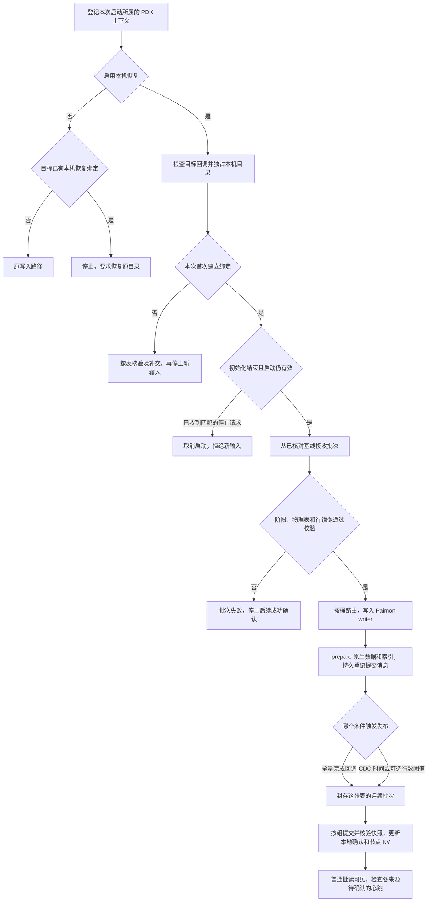
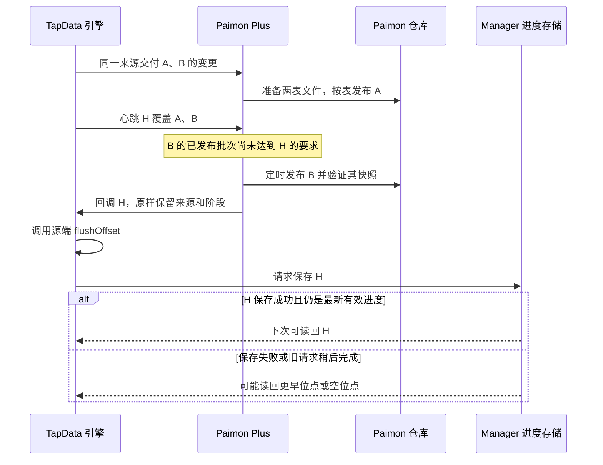
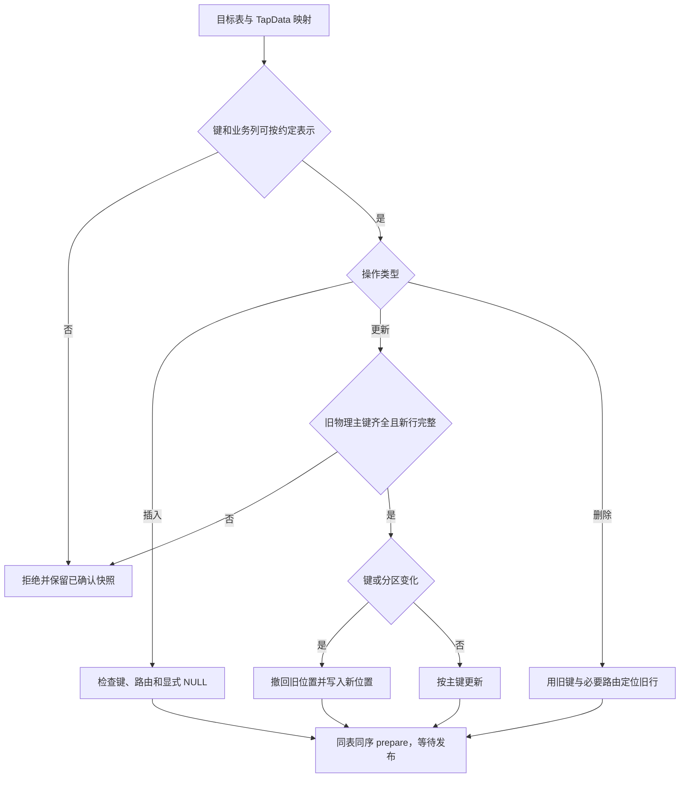
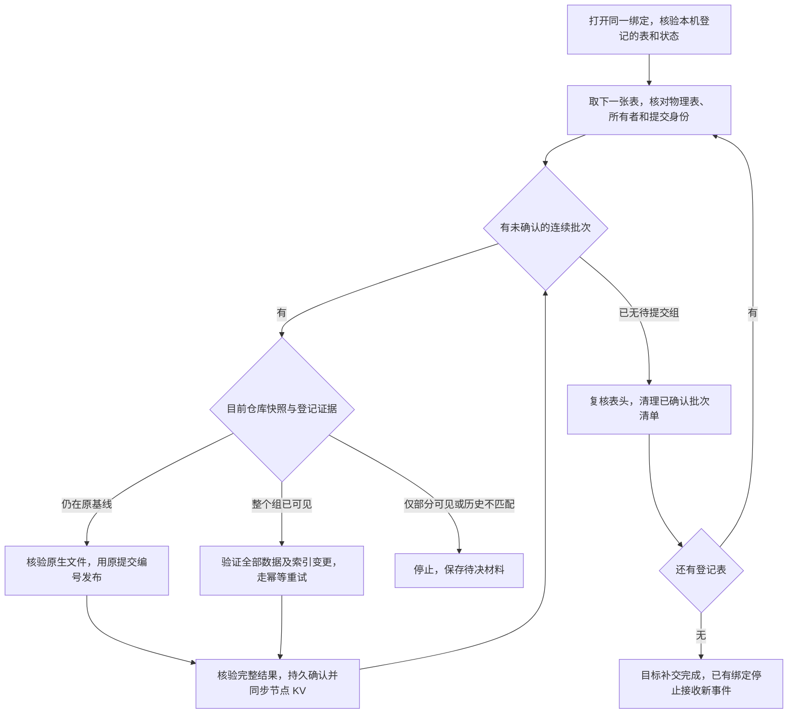

# Paimon Plus 写入、提交与恢复的一致性流程

适用于此分支的 Paimon Plus 目标连接器、Apache Paimon 1.3.2 和本地 TapData 引擎 `65add935fdee`。业务使用普通批读，不消费 changelog。

**验收标准**　取同一个源位置 P，在已追平的目标快照上比较完整主键集合和每个映射字段。源在 P 前删除的键也必须从目标消失。允许一个事件重复交付，也允许产生额外快照。跨表读取需要逐表选取已经覆盖 P 的快照；这些表的快照各自发布。

同一个批次可能多次送达连接器。Paimon 用同一身份和编号核验已发布的提交组；新的业务重放可能使用新的提交编号、产生新的快照。业务依赖的是主键表在相同源位点收敛，单次调用、单个快照和跨表同一事务分别有不同的成立条件。

## 哪种运行方式能保证什么

| 运行情形 | 可观察的保证 | 边界 |
| --- | --- | --- |
| 未配置 `localRecoveryDir` | 保持原连接器的写入、提交和读取行为。已提交数据由 Paimon 快照保存。 | 进程内尚未提交的批次没有这套本机恢复清单，不承诺本流程的故障恢复语义。 |
| 开启本机恢复，首次从已核对的源目标基线启动 | 正常首次全量末尾按表发布，CDC 按配置提交。完整、有序的同源输入重复交付后，可在共同位点逐主键对账。 | 新目录只能证明本次创建了目标绑定；源日志完整、没有跳错/漏投、同键顺序正确仍是前提。把已中断的旧任务指向新目录不能建立业务基线。 |
| 已绑定目标再次启动，包括正常停机、强退或没有新输入 | 先核验并补交本机已接收的连续前缀。全部补交成功后仍以 `PAIMON_RECOVERY_SOURCE_POSITION_UNVERIFIED` 拒绝新 DML 和位点回调。 | 当前目标 PDK 无法知道源端实际选择的恢复位置。不能自动承诺跨重启追平；已经在源端发生却从未送达目标的删除，也不在清单中。 |
| 本机盘丢失、目录换机、仓库文件缺失、历史分叉或证据不完整 | 在相应校验处停止，已经发布的快照仍可能可见。 | 保留仓库和本机现场；用独立空目标和可核对的源快照重建，包含删除键在内对账后再切换。 |

## 1. 从输入到普通读可见

`prepare` 之前，writer 可以在内存中缓冲或使用本机 spill。准备完成后，数据和索引由 Paimon 放进 warehouse；目标专用本机目录保存版本化的原生 `CommitMessage` 和顺序元数据。**写批成功**要求该批已登记；**业务可见**要求 Paimon 已发布快照。两者之间允许相隔整个全量阶段。CDC 时间窗口控制目标快照的提交频率，源位点和 Manager 进度仍由引擎分别维护。若绑定与配置冲突、锁忙或节点 KV 不匹配，启动直接失败。

全量提交边界是引擎交给连接器的 `afterInitialSync(table)`。引擎记录单表 `OVER` 时，其他表可能仍在扫描。同一物理表由多个来源供数时，完成回调只封闭当时已接收的前缀；后续全量行仍可形成下一段。有开放全量的表会暂缓其 CDC 定时/行数提交。一次发布可包含 APPEND 和 COMPACT 两个原生快照，大区间也可拆组，无法承诺每表任何时候都恰好一个 snapshot。[写入和结束回调](../../main/java/io/tapdata/connector/paimon/service/PaimonService.java) · [表提交器](../../main/java/io/tapdata/connector/paimon/recovery/LocalRecoveryTable.java)

## 2. 多表 CDC 与引擎位点

每个心跳属于 `nodeIds[0]` 指定的来源。协调器记下该来源在各表已经接受的批号，同时计入来源未知的全量批次。仅当所有相关表的已提交批号覆盖该心跳，才允许调用引擎；同来源回调有序，其他来源的提交不能替它证明完成。这里依赖引擎让该心跳排在它所覆盖的数据之后。同源不同键可并发，同键变更必须保持业务顺序。[心跳协调器](../../main/java/io/tapdata/connector/paimon/commit/PaimonMicroBatchCoordinator.java)

| 输入或故障点 | 实际行为 |
| --- | --- |
| 初始流位点 P0 通过并发 worker 到达 | 强模式只处理每个来源的首个有效、只有流位点的 INITIAL 心跳，并等待该来源已有依赖。重复 P0 或 CDC 之后迟到的 INITIAL 不得把阶段回退。 |
| 串行引擎滤掉只有流位点的 INITIAL 心跳 | 空表可先记录 `OVER`，进度中却没有 P0。目标无法补造未收到的源位点。 |
| A 已发布、B 尚未发布 | 业务可暂时看到 A 的新值和 B 的旧值。覆盖两表的 H 仍被扣住。 |
| 引擎已 flush 源端，Manager 保存失败或旧保存覆盖新保存 | 同一运行中，如果源片段能按顺序完整重放，主键表可以再次收敛。再次启动时即使测试程序读得到 P2，目标 PDK 仍不能证明源端采用了 P2，因此禁止自动续跑。 |

可重复实验中，源在 A 上把键 1 移到 3 并删除键 2，在 B 上更新键 7。第一次回调 P2 时目标已达到 A=`{3:moved}`、B=`{7:changed,8:keep}`。模拟 Manager 保存失败后在同一进程重复交付，表快照从 2/2 变为 3/3，键值保持一致。[联动测试与原始断言](../../../tasks/local-recovery/e2e/README.md)

## 3. 按行、按桶判断能否收敛

| 条件 | 一致性措施或拒绝理由 |
| --- | --- |
| `HASH_FIXED` | Paimon 根据键和分区计算固定桶。改键、搬分区时旧位置必须被撤回；只向新桶插入会留下旧键。 |
| `HASH_DYNAMIC` | 使用原生 hash 分桶分配器；提交消息覆盖数据及适用的 hash 索引。故障测试移除旧 writer 的 spill 后，用登记的消息恢复，并核对后续路由。 |
| `KEY_DYNAMIC` 跨分区 | 通过原生全局索引处理同键迁移。禁止有限的跨分区索引 TTL，以免仍存在于旧分区的键在重建索引时被漏掉。 |
| `POSTPONE_MODE`、无主键表或改变合并/删除语义的表 | 强模式拒绝。延迟分桶文件可能已经发布，但普通批读尚看不到；追加表及忽略删除的表也无法按此口径处理重放。 |
| 已有物理表的列或精度不同 | 拒绝静默漏列及可能合并主键的映射，如 INT→FLOAT。保留 INT→BIGINT 等无损扩宽。时间主键出现无法表示的亚毫秒时拒绝；旧快照仍能读到原键。 |
| 显式 NULL、缺失列与默认值 | 带物理默认值的列收到显式 NULL 时拒绝，避免读回默认值。省略字段和明确发送 NULL 分开处理，可空且无默认值的列仍能保存 NULL。 |
| `scan.fallback-branch` | 强模式拒绝。普通批读按分区选择分支；若允许写入，主分支新增一行即可遮住 fallback 中同一分区的其他键。 |
| 外部 writer、DDL、历史改写 | 任务需独占物理表。当前强模式拒绝直接 drop/truncate；运行中 schema 或历史变化需核对表世代和快照证据。源端丢弃错误事件、同键乱序或已有错误基线也会破坏逐键承诺。 |

一次改键能说明为什么要检查旧键。假设目标已有 `p1/7`，源把它改为 `p2/8`。旧版在默认配置下接到只有 after 的更新时，三个桶模式都会确认成功，普通批读却同时返回 `p1/7` 和 `p2/8`。修复后，强模式对整批 UPDATE 先检查 before 中的全部物理主键分量，缺失或为 NULL 就拒绝。固定桶和动态哈希桶若使用复合键 `(part,id)`，需提供两个旧值；跨分区全局索引表若只以 `id` 为键，仅给旧 `id` 即可定位原记录。旧非键业务列可省略。开启 `enablePrimaryKeyUpdate` 时检测到改键会发送 DELETE + INSERT，关闭时有旧键的更新仍会用 UPDATE_BEFORE 撤回旧行，再用 UPDATE_AFTER 写新行。普通模式保留 after-only 更新行为。

写前验证和三个分桶实现见[物理表准入](../../main/java/io/tapdata/connector/paimon/schema/PaimonRecoveryAdmission.java)、[行镜像校验](../../main/java/io/tapdata/connector/paimon/schema/PaimonDmlImageValidator.java)及[桶策略](../../main/java/io/tapdata/connector/paimon/write/bucket)。内核行为见 [Paimon 1.3.2 主键表](https://paimon.apache.org/docs/1.3/primary-key-table/overview/)、[默认值](https://paimon.apache.org/docs/1.3/flink/default-value/)及[按分区读取 fallback](https://paimon.apache.org/docs/1.3/maintenance/manage-branches/#batch-reading-from-fallback-branch)。

## 4. 强退、幂等补交和清理

| 中断位置 | 重启后如何判断 |
| --- | --- |
| writer 内存或 spill 中，批次未持久登记 | 该批尚无成功写入确认；未登记尾部不用于补交。要覆盖这批业务变更，需要源端保有可核对的重放起点。 |
| 已登记成功，但尚未发布全量或 CDC snapshot | 即使没有新输入也能补交已登记前缀。异常重启可能让部分全量比正常完成回调更早可见。 |
| Paimon 已完整发布，但本机仍显示待确认 | 使用原 `commitUser`、提交编号、快照指纹及数据/索引变更验证整个组。验证成功再确认；不会仅凭编号就跳过。 |
| 预期 APPEND + COMPACT，只能证明 APPEND | 冻结该组，保留清单；不盲目重交或回滚可见快照。A 表已经安全发布，不能据此断言 B 表也完成。 |
| 已本机确认，节点 KV 更新或清理中断 | 先同步可核对的目标提交编号，再回收已确认的清单。保留绑定、表世代和锚点。这里的 KV 编号属于 Paimon 提交，不代表 Manager 已保存源位点。 |
| 启动与停机交错 | 启动先登记本次 PDK 上下文。在外部初始化完成后再次核对归属才开放输入。配置读取或启动日志阻塞时，即使 stop 先返回，旧 start 也无法随后发出位点回调。旧上下文迟到的 stop 不能关闭新实例。 |
| 正常停止、资源超时 | 正常停止对可排空的 CDC 尝试提交，开放全量留待恢复。旧 worker 或维护线程尚未确认退出时，不能把同一 writer/目录交给另一个活跃实例。 |

本机消息有完整性校验。仓库侧核验涉及所引用文件的存在性和长度、快照世系、manifest 与索引变更；同长度的数据文件被外部静默替换不在此校验的保证内。业务需要保留所有准备文件到恢复完毕，并留足快照历史供验证。[本机清单](../../main/java/io/tapdata/connector/paimon/recovery/PreparedMessageStore.java) · [发布核验](../../main/java/io/tapdata/connector/paimon/recovery/PublicationVerifier.java)

## 复现和验收

- **位点与多表。** `run-anchor-probe.sh --anchor`、`--concurrent`、`--coupled` 分别覆盖串行、并发及跨 JVM 中断。使用真实 TapData 引擎方法、目标连接器和 Paimon 读写，源事件及 Manager 持久化边界由夹具提供。
- **物理数据。** `LocalRecoveryImageAudit`、`FallbackBranchReviewProbe` 和 `TemporalPrimaryKeyProbe` 对照正常输入、拒绝原因和拒绝后的普通批读结果。
- **画图时补充的回归。** `PaimonRecoveryUpdateRoutingIntegrationTest` 对三种桶分别检查有无旧键、改键和迁移后的实际键值，并验证普通模式的 after-only 更新。`PaimonConnectorControlTest` 在读取配置和启动日志处分别暂停启动，交错执行 stop，验证晚到的启动或停止不会错误开放或关闭新会话。
- **分桶与故障。** `PaimonHashIndexRecoveryIntegrationTest`、`PaimonKeyDynamicRecoveryIntegrationTest`、`PaimonStagingRecoveryIntegrationTest` 分别验证分桶索引、跨分区恢复和原生半提交。直接调用 service 的恢复试验覆盖目标端机制；正式 PDK 的启动准入另由联动测试验证。

完整执行方法见[测试入口](../../../tasks/local-recovery/e2e/README.md)。线上签收还需要冻结真实源位点、取得该位点的源端基准，并读取覆盖此位点的各目标表快照，对缺键、多键、值和删除逐项核对。
