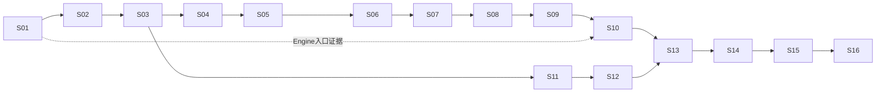

# 实施计划：Paimon StreamRead 连接器内重构

- 日期：2026-09-22；状态：计划已编写，尚未开始实现；提交计划不代表待决迁移政策已经确认。
- 分支：`codex/paimon-stream-read`；基于 `hotfix-spill@7c40958fdaf3c4f76ef8eb0312550ad16ee81faf`，Spec 提交 `d6c62884`。
- 工作树：`/Users/SL/.codex/worktrees/paimon-stream-read/tapdata-connectors`。
- 唯一修改范围：`connectors/paimon-plus-connector/`，包括代码、配置、测试、脚本和文档；不修改 Engine、PDK、其他连接器、父 pom。
- 依据：[Spec v1.1](../docs/specs/paimon-stream-read-connector-only-spec-v1.md)、[源码审查记录](../docs/specs/paimon-stream-read-connector-only-review-v1.md)。任务状态只维护 [todo.md](todo.md)。
- 历史：本目录原有 Spill 计划及清单均已完成，归档为 [历史 Plan](paimon-spill-completed-plan.md) 和 [历史 Todo](paimon-spill-completed-todo.md)。其中测试计数和“未提交”等措辞属于当时记录，不作本次状态。根目录 tasks 不修改。

## 1. 目标与架构决定

修复 next 位点额外加一、位点越过未交付事件、半 plan 取消仍推进、空表停轮询、多表永久循环、低流量不刷新及资源关闭竞争。保持 TapData 能力入口、事件类型、错误传播、offset 恢复和生命周期体系。

1. 保留 Paimon ReadBuilder → StreamTableScan → TableRead；完整读取 plan 后才产生 PlanFinished，单一 Delivery Loop 提交深复制的候选 offset。
2. Coordinator 串行管理调度状态，worker 与交付线程通过完成 mailbox 通知；无进展返回 IDLE，不能等待一个不会产生的标记。
3. 每个调度任务最多调用一次原生 plan；原生调用本身无硬上限。公平调度依赖调用能返回，停止超时报告失败并保留资源，不能伪装物理取消。
4. 新 offset 明确 next-to-consume；timestamp 在入口捕获共同 T，查 snapshot/changelog；schema guard 在新结构数据入队前失败。
5. 无业务数据但位点推进时使用 PDK HeartbeatEvent。accept、flushOffset、stateMap 均不作为持久化确认。
6. Consumer 草案默认 none；可选 fixed-start 永不前移周期 start。续租、初始化 deadline、watchdog 与业务读取分离；保护失败为 sticky failure。
7. 复用 PaimonServiceLifecycle、PaimonStopController、PaimonStopResources、PaimonGuardedReader 和现有 RowKind/codec；不新增平行的 Service 资源账本或改动写入算法。

源码基线固定为 Paimon release-1.3 `5c59e6cb01ed0b29563371f56e14fcade4597a2e`；构建依赖为 1.3.2。PDK 为 2.0.8-SNAPSHOT，需记录实际解析 artifact。JDK 17 执行验证，当前模块 source/target 为 Java 8；历史 Spill 文档的 Java 11 不覆盖当前 pom。

## 2. 依赖顺序与交付切片

| 顺序 | 任务 | 可验证产出 |
|---|---|---|
| S01–S03 | 基线/平台入口取证、offset、时间与范围 | 先暴露平台适配和恢复边界风险；严格位点协议有实表及编解码证据。 |
| S04–S06 | schema guard、单表 plan 读取、候选位点交付 | 使用真实 Paimon 数据贯通单表读取到 fake PDK 回调；失败不能越过 plan。 |
| S07–S09 | 多表调度、停止接缝、配置 | 公平重派发、无进展完成、受控资源退出和配置校验。 |
| S10–S12 | none 模式入口接线、固定 Consumer 注册、续租 | 先形成 none 模式完整能力入口；Consumer 组件独立验证后再接入。 |
| S13–S15 | 全量至增量保护、模式实表、Engine 故障验证 | 验证长期保护生命周期、实际事件语义及平台恢复，不改内核。 |
| S16 | 最终回归与交付复核 | 全部验收矩阵、来源注释和本地提交闭环；区分发布支持与未验证组合。 |



执行默认按 S01 至 S16 顺序，检查点置于每 2–3 项后。S11 的注册组件可在 S03 后独立开发，但本计划不启动并行代理；如以后并行，Service/Connector 接线必须串行，测试目录及可变状态隔离。每项预计 2–5 个实现/验证文件，任务清单状态更新另计；超出 5 个实质文件时先拆分，不把多个责任塞进一个提交。

S02–S09 的新组件先由模块测试实际调用，原入口保持可构建；S10 是 none 模式切换点，不能提前把新版 timestamp offset 交给旧 streamRead 解析器。S10 之前不部署中间提交；S10–S12 遇 fixed-start 明确报告尚未完成接线，不能静默按 none 运行。S13 后才具备固定保护完整链路。中间提交是可验证增量，不代表独立发布版本；不为此新增永久的生产双实现开关。

## 3. 前置决定与验证门槛

| 项目 | 当前状态 | 对任务的约束 |
|---|---|---|
| D01 旧 Map 迁移 | 已提问，未收到答复；建议拒绝歧义旧格式，显式重新初始化。 | 可实现明确的 v1 内部协议；S10 的对外拒绝/迁移行为启用前必须确认并同步 Spec。不得默默加自动猜测兼容。 |
| D02 Consumer 默认策略 | 草案建议 none，fixed-start 显式选用。 | S09 暂按草案设计验证；S10 对外接线前确认默认值。固定保护的永不前移规则不因默认选择而改变。 |
| E01 真实 Engine 版本与初始化/Heartbeat 契约 | 本地源码只读证据，部署组合未验证。 | S01 尽早取证，S10 前确认正常路径会初始化新版 offset；S15 证明顺序与持久化故障恢复。缺环境时如实记录阻塞，不能用 fake consumer 代替。 |
| 用户是否授权编码 | 当前仅授权 worktree、Spec/Plan 与本地提交。 | 本轮完成文档后停止。后续开始实施需用户明确指示；不因计划已提交自行开展 Java 改造。 |

技术事实通过源码和测试解决；产品取舍不确定时按 interview-me 提出带建议的单一问题。已经授权的常规实现和提交不重复请求许可。检查点用于自查与证据核对，不给每个任务额外增加人为批准步骤。

## 4. 验证命令与证据

所有命令从新 worktree 根目录执行，先将 JAVA_HOME 指向本机实际可用 JDK 17 并记录 `java -version`。以下 B/F/G 是验证模板名称，不是仓库已有脚本；F 的 TEST_CLASSES 必须替换成 todo 中该任务的实际测试类名。

B（编译，不触发 package）：

```bash
mvn -pl connectors/paimon-plus-connector \
  -Dmaven.gitcommitid.skip=true \
  -Dtapdata.pdk.runner.version=2.8-SNAPSHOT \
  -Dpdk-error-code.version=2.8-SNAPSHOT \
  -DskipTests test-compile
```

F（定向）：

```bash
mvn -pl connectors/paimon-plus-connector \
  -Dmaven.gitcommitid.skip=true \
  -Dtapdata.pdk.runner.version=2.8-SNAPSHOT \
  -Dpdk-error-code.version=2.8-SNAPSHOT \
  -Dtest=TEST_CLASSES test
```

G（本模块完整回归）：

```bash
mvn -pl connectors/paimon-plus-connector \
  -Dmaven.gitcommitid.skip=true \
  -Dtapdata.pdk.runner.version=2.8-SNAPSHOT \
  -Dpdk-error-code.version=2.8-SNAPSHOT test
```

- 上述 runner/error-code 参数沿用 Spec 的本地验证模板，不代表允许升级 pom 或改变生产依赖。S01 核实实际解析结果，不可用 fallback 参数掩盖依赖差异。
- 未运行 Maven；本轮不沿用历史 688 项等成绩。S01 重测同环境基线，记录失败方法、环境、版本及报告；后续比较新增失败，基线失败也必须明确列出。
- 新实表测试采用 `*IntegrationTest`，确认 Surefire XML 中实际类名、tests > 0 和 skipped；不加忽略测试开关来制造通过。并发故障用 latch/barrier、可控时钟，断言事件/位点顺序，避免仅统计行数。
- catalog、测试临时文件、子进程日志均放模块 target 内；需要改变临时目录默认行为时只改模块测试配置。提交精简且脱敏的证据到模块 docs/validation，构建产物不提交。
- 不运行 package，当前复制目标会写模块外 connectors/dist。若 Engine 实验必须新 JAR，先在模块 pom 单独增加显式启用、仅输出本模块 target 的打包配置，并单独验证/提交；不得假设外部目录产物符合范围。
- F 已完成编译时无需为了形式紧接着重复 B。每项执行相关 F，检查点运行相关回归，S01/S16 运行 G；没有新变化或风险不重复全量。
- Engine 黑盒场景记录真实 source/target 版本、事件序列、持久化 offset 与重启结果；禁止读取未授权真实业务数据，使用现有授权测试环境。环境不可用就标未验证，不修改 Engine 来绕过。

## 5. 每项提交与注释规范

每个实现单元依次完成实现、定向验证、审查、本地提交，然后更新 todo 的证据和 SHA。不得把计划勾选当作测试证据；失败单元不标完成。任务记录与相应实现同一提交即可，记录自身 SHA 可放下一次记录或最终账本，不为自引用反复 amend。

- 提交只精确选择本模块该任务路径；核对 `git diff --check`、`git diff --cached --check` 和 staged diff，确保没有凭据、构建产物或无关暂存内容。
- 语义适配处写明来源项目、固定 commit/artifact、完整源码路径、类/方法/行号，以及为何适配。至少涵盖位点、时间、历史、schema、Consumer、Heartbeat 和取消准入。
- 按职责使用 fix/refactor/test/docs 类型，提交说明记录变更原因、源码基线和验证命令。默认只提交 `codex/paimon-stream-read` 本地分支，不 push、不 merge。
- 原工作区 `hotfix-spill` 的暂存旧稿及未跟踪文档保持不动；新 worktree 只从 HEAD 和本次明确复制的两份 Spec 文档建立。

## 6. 风险与收敛

| 风险 | 影响 | 缓解与验收 |
|---|---|---|
| 新旧 offset 混用或入口分批切换 | 跳读/启动失败 | D01 + S10 原子接线；v1 直接 restore(next)，禁止 +1。 |
| Engine 吞异常或 Heartbeat 超过未完成数据 | 错误候选被保存 | S01 前置契约验证、S15 真目标故障矩阵；限定支持组合。 |
| plan() 长调用或 I/O 无法中断 | 多表延迟、停止无法释放 | S07/S08 注入阻塞、报告失败并保留资源；不承诺严格时限。 |
| 半 plan、队列背压与取消交错 | 候选 offset 越界 | S05/S06/S08 完整标记和准入门，取消无标记。 |
| timestamp 历史多、提交时钟回拨 | 初始化慢、错误边界 | S03 倒序元数据查询、冻结上界和取消；测耗时，不假定单调时间。 |
| schema 演进发生在读取中 | 字段遗漏/错配 | S04/S14 结构绑定和新 plan 检查，历史投影独立验证。 |
| Consumer 清理无 CAS、文件曾被删除 | 历史保护空窗 | S11–S13 独立 writer、注册/续租交错和缺文件测试；不声称事务租约。 |
| fixed-start 周期无限增长 | 保留成本高 | 记录 start/next/租约年龄，不自动前移或删文件；D02 明确默认。 |
| 停止改造牵连写链路 | 既有 Spill/提交回归 | S08/S16 复用已有资源/控制器并回归有限读、写提交与停止。 |

## 7. 完成定义

S01–S16 和检查点都有实际证据，D01/D02 已确认；新测试通过，既有失败有同环境比较及处理结论，未验证的 Engine/存储组合明确列出。每项实现含源码注释且有本地 commit，工作树无遗留未提交实现，所有变更在模块内。本轮交付只完成 Spec/Plan 的版本化，不勾选任何实施任务。
